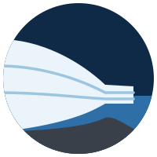

<p align="center"></p>

# Nunatak.jl

Nunatak is a differentiable ice-sheet and ice-shelf model built on
[Oceananigans.jl](https://github.com/CliMA/Oceananigans.jl). It runs on CPUs and GPUs, and Enzyme computes
gradients through whole simulations for inversions and sensitivity studies.

## Features

- **Stress balances**: shallow ice (SIA), the shallow-shelf approximation, and depth-integrated viscosity
  (DIVA, `DIVAShear()`), on a staggered C-grid with no-slip or free-slip side walls.
- **Velocity solver**: Picard iterations around a preconditioned conjugate-gradient solve, with Jacobi, diagonal
  or geometric-multigrid preconditioners.
- **Rheology and sliding**: Glen's flow law with a constant or Arrhenius rate factor, and Weertman or regularized
  Coulomb friction.
- **Grounding lines and calving fronts**: subgrid grounded fractions, calving-front stresses, and a front that
  advances through partially filled cells.
- **Thermodynamics**: enthalpy with cold and temperate ice, basal water and strain heating, on a terrain-following
  σ-grid.
- **Adjoints**: Enzyme reverse-mode rules for the velocity solve, including a fixed-point adjoint of the Picard
  iteration, plus checkpointed gradients through time stepping.

## Installation

Nunatak is not registered yet. Add it from its repository:

```julia
using Pkg
Pkg.add(url = "https://github.com/aklocker42/Nunatak.jl")
```

## Example

A Halfar (1983) dome evolving under the shallow-ice approximation:

```julia
using Oceananigans, Nunatak

spy = 31556926
grid = RectilinearGrid(CPU(); size = (97, 97), halo = (4, 4), x = (-1212.5e3, 1212.5e3), y = (-1212.5e3, 1212.5e3),
                       topology = (Bounded, Bounded, Flat))

model = IceSheetModel(grid; Nσ = 10, stress_balance = ShallowIce(),
                      rheology = GlenFlowLaw(grid; rate_factor = 1e-16 / spy, exponent = 3),
                      friction = WeertmanFriction(grid; coefficient = 1e18, exponent = 1))

set!(model, H = (x, y) -> 3600 * max(0, 1 - (hypot(x, y) / 750e3)^(4 / 3))^(3 / 7))

for _ in 1:100
    time_step!(model, 1spy)
end
```

`examples/` has a friction inversion with Enzyme gradients and two polythermal slab cases.

## Validation

The test suite runs on CPU and GPU. `benchmarks/` holds longer runs against published solutions:

| Benchmark | Reference |
|---|---|
| Isothermal Halfar dome, 25 kyr | Halfar (1983); Bueler et al. (2005), Test B |
| EISMINT II experiment A, 200 kyr | Payne et al. (2000) |
| Floating shelf in a channel with an advancing calving front | MITgcm STREAMICE `verification/halfpipe_streamice` |
| Steady and cyclic polythermal slabs (in `examples/`) | Kleiner et al. (2015) |

See `benchmarks/README.md` for how to run them and for the reference values.

## Citing

See `CITATION.cff`.

## License

MIT, see `LICENSE`.
